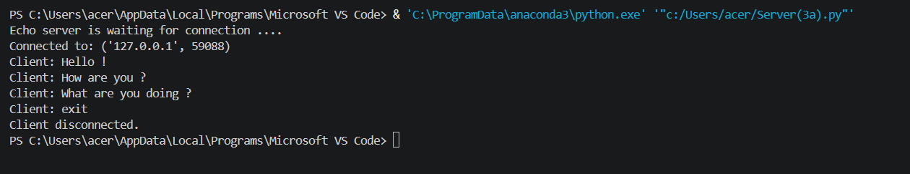
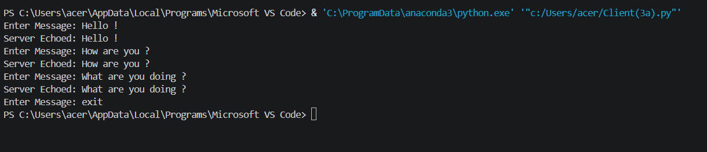

# 3a.CREATION FOR ECHO CLIENT AND ECHO SERVER USING TCP SOCKETS
# AIM
To write a python program for creating Echo Client and Echo Server using TCP
Sockets Links.
## ALGORITHM:
1. Import the necessary modules in python
2. Create a socket connection to using the socket module.
3. Send message to the client and receive the message from the client using the Socket module in
 server .
4. Send and receive the message using the send function in socket.
## PROGRAM
#### SERVER PROGRAM:
```

import socket

server_socket = socket.socket(socket.AF_INET, socket.SOCK_STREAM)

host = '127.0.0.1'
port = 5000

server_socket.bind((host, port))
server_socket.listen(1)

print("Echo server is waiting for connection ....")

client_socket, addr = server_socket.accept()
print("Connected to:", addr)

while True:
    data = client_socket.recv(1024).decode()

    if not data:
        print("Client disconnected.")
        break

    print("Client:", data)

    if data.lower() == "exit":
        print("Client disconnected.")
        break

    client_socket.sendall(data.encode())

client_socket.close()
server_socket.close()

```

#### CLIENT PROGRAM
```

import socket

client_socket = socket.socket(socket.AF_INET, socket.SOCK_STREAM)

host = '127.0.0.1'
port = 5000

client_socket.connect((host, port))

while True:
    message = input("Enter Message: ")

    client_socket.sendall(message.encode())

    if message.lower() == 'exit':
        break

    data = client_socket.recv(1024).decode()

    print("Server Echoed:", data)

client_socket.close()

```
## OUPUT







## RESULT
Thus, the python program for creating Echo Client and Echo Server using TCP Sockets Links 
was successfully created and executed.
